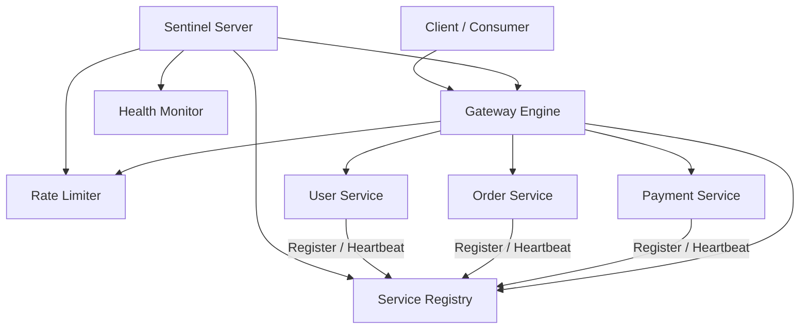

<a href="https://balajivs.me"></a>

# Sentinel

**A self-hosted API gateway and service discovery server for Java-based distributed systems.**

Sentinel is a centralized entry point for backend services, providing service registration, discovery, request routing, traffic control, and distributed rate limiting.

Built with Java and Spring Boot, Sentinel aims to simplify the infrastructure required to operate distributed backend applications without requiring a heavyweight orchestration platform.

> Register your services. Route your traffic. Control your infrastructure.

---

## Overview

Sentinel acts as both an **API Gateway** and a **Service Registry**.

Backend services register their instances with Sentinel, periodically report their health through heartbeats, and become discoverable to the gateway. Incoming requests are routed to healthy instances based on configured routing rules and load-balancing strategies.

Sentinel centralizes infrastructure concerns that would otherwise be implemented independently across backend services.

### Core Capabilities

- Service registration and discovery
- Dynamic service instance registry
- Heartbeat-based instance health tracking
- Reverse proxy and request routing
- Load balancing across service instances
- Distributed rate limiting
- API key authentication
- Traffic policies
- Circuit breakers and resilience
- Centralized metrics and observability

---

## Architecture



### Request Flow

```text
Client
  │
  │ HTTP Request
  ▼
Sentinel Gateway
  │
  ├── Resolve route
  ├── Authenticate request
  ├── Evaluate traffic policy
  ├── Apply rate limiting
  ├── Discover healthy service instances
  ├── Select an instance
  └── Forward request
          │
          ▼
    Backend Service
          │
          ▼
    Response → Client
```

### Service Registration Flow

```text
Backend Service Startup
        │
        ▼
Register with Sentinel
        │
        ▼
Service Instance Added to Registry
        │
        ▼
Periodic Heartbeats
        │
        ▼
Instance Marked Healthy
        │
        ▼
Available for Gateway Routing
```

Instances that stop reporting heartbeats within their configured lease duration are marked unhealthy and excluded from routing.

---

## Service Registry

The registry maintains the runtime state of registered services and their instances.

A service may have multiple instances running on different hosts, ports, or containers.

### Service Instance Metadata

Each registered instance may contain:

| Field | Description |
|---|---|
| `serviceId` | Logical service identifier |
| `instanceId` | Unique instance identifier |
| `host` | Hostname or IP address |
| `port` | Service port |
| `scheme` | HTTP or HTTPS |
| `status` | Instance lifecycle status |
| `metadata` | Additional user-defined attributes |
| `registeredAt` | Registration timestamp |
| `lastHeartbeat` | Last heartbeat timestamp |
| `leaseDuration` | Registration lease duration |

### Instance Lifecycle

```text
          REGISTER
              │
              ▼
         REGISTERED
              │
              ▼
           HEALTHY
              │
       ┌──────┴──────┐
       │             │
  HEARTBEAT     HEARTBEAT
   RECEIVED       EXPIRED
       │             │
       ▼             ▼
   HEALTHY      UNHEALTHY
                     │
                     ▼
                 DEREGISTER
```

### Registry Operations

- Register a service instance.
- Update instance metadata.
- Renew registration leases.
- Deregister an instance.
- Retrieve registered services.
- Retrieve instances for a service.
- Filter instances by health status.
- Discover instances dynamically.

---

## Service Registration

Services register themselves with Sentinel through a registration API.

Example registration request:

```http
POST /registry/services/register
Content-Type: application/json
```

```json
{
  "serviceId": "user-service",
  "instanceId": "user-service-01",
  "host": "192.168.1.10",
  "port": 8081,
  "scheme": "http",
  "metadata": {
    "version": "1.0.0",
    "environment": "development"
  }
}
```

Example heartbeat:

```http
POST /registry/services/heartbeat
Content-Type: application/json
```

```json
{
  "serviceId": "user-service",
  "instanceId": "user-service-01"
}
```

Example deregistration:

```http
DELETE /registry/services/user-service/instances/user-service-01
```

Registration and heartbeat APIs will be secured in production deployments to prevent unauthorized service registration.

---

## Service Discovery

Sentinel resolves logical service identifiers into healthy service instances.

Example:

```text
user-service
    │
    ├── 192.168.1.10:8081  HEALTHY
    ├── 192.168.1.11:8081  HEALTHY
    └── 192.168.1.12:8081  UNHEALTHY
```

Only healthy instances are eligible for traffic routing.

Service discovery can be consumed by:

1. Sentinel's gateway engine for request routing.
2. External services through the discovery API.
3. Future client libraries supporting registry subscriptions or caching.

---

## Gateway & Routing

Sentinel provides a centralized HTTP entry point for registered backend services.

### Example Route Configuration

```yaml
gateway:
  port: 8080

routes:
  - id: users
    path: /api/users/**
    serviceId: user-service

  - id: orders
    path: /api/orders/**
    serviceId: order-service

  - id: payments
    path: /api/payments/**
    serviceId: payment-service
```

Requests are routed using logical service identifiers rather than hardcoded instance addresses.

```text
GET /api/users/42
        │
        ▼
Sentinel :8080
        │
        ▼
user-service
        │
        ▼
Healthy Instance Selection
        │
        ▼
192.168.1.10:8081
```

### Routing Capabilities

- Path-based routing.
- HTTP method-based routing.
- Service-based routing.
- Route predicates.
- Request and response filters.
- Header manipulation.
- Path rewriting.
- Configurable timeouts.
- Dynamic instance resolution.

---

## Load Balancing

Sentinel distributes incoming requests across healthy instances of a registered service.

Initial load-balancing strategies:

- Round Robin
- Random
- Weighted Round Robin

Future strategies:

- Least Connections
- Least Response Time
- Consistent Hashing
- IP Hash

Load-balancing strategies should be pluggable and configurable per route or service.

---

## Rate Limiting

Sentinel includes a configurable rate-limiting engine to control request traffic.

### Planned Algorithms

| Algorithm | Characteristics |
|---|---|
| Fixed Window Counter | Simple and memory-efficient |
| Sliding Window Log | Accurate window-based limiting |
| Sliding Window Counter | Approximation with lower memory overhead |
| Token Bucket | Supports controlled bursts |
| Leaky Bucket | Smooths outgoing traffic |

### Rate Limit Dimensions

Policies can be applied based on:

- IP address
- API key
- User identity
- Service
- Route
- HTTP method
- Tenant

### Example Policy

```yaml
rate-limiting:
  enabled: true

  policies:
    - id: global-api
      algorithm: token-bucket
      capacity: 100
      refillRate: 20
      refillPeriod: 1s
      key: ip

    - id: user-api
      algorithm: sliding-window-counter
      limit: 60
      window: 1m
      key: userId
```

Distributed rate limiting will use Redis-backed state to maintain consistency across multiple Sentinel instances.

---

## Technology Stack

| Component | Technology |
|---|---|
| Language | Java |
| Runtime | Java 21+ |
| Framework | Spring Boot |
| HTTP Engine | Reactor Netty |
| Gateway | Custom reactive gateway engine |
| Service Registry | In-memory registry initially |
| Distributed State | Redis |
| Persistence | PostgreSQL (future/configuration persistence) |
| Metrics | Micrometer |
| Monitoring | Prometheus |
| Visualization | Grafana |
| Containerization | Docker |
| Testing | JUnit 5, Testcontainers |
| Load Testing | k6 |
| CI/CD | GitHub Actions |

---

## Architecture Principles

- **Self-hosted:** Run Sentinel within your own infrastructure.
- **Configuration-first:** Configure routes and policies without modifying application code.
- **Service-oriented:** Discover backend instances through logical service identifiers.
- **Stateless gateway:** Keep gateway request processing stateless wherever possible.
- **Dynamic discovery:** Avoid hardcoding backend instance addresses.
- **Extensible:** Keep routing, rate-limiting algorithms, and load-balancing strategies pluggable.
- **Observable:** Provide metrics, logs, health information, and operational visibility.
- **Resilient:** Treat downstream failures as expected operational scenarios.
- **Incremental architecture:** Start with a single server and evolve toward distributed deployment when necessary.

---

## Development Roadmap

### Phase 1 — Core Gateway

- [ ] Spring Boot application bootstrap
- [ ] Reactive HTTP server
- [ ] Reverse proxy implementation
- [ ] Static route configuration
- [ ] Request forwarding
- [ ] Request and response header propagation
- [ ] Configurable timeouts
- [ ] Graceful shutdown

### Phase 2 — Service Registry

- [ ] Service registration API
- [ ] Instance identifiers
- [ ] Service instance metadata
- [ ] Heartbeat API
- [ ] Lease expiration
- [ ] Instance health lifecycle
- [ ] Deregistration
- [ ] Service discovery API
- [ ] In-memory registry implementation

### Phase 3 — Dynamic Routing & Load Balancing

- [ ] Route resolution by service ID
- [ ] Dynamic instance resolution
- [ ] Round Robin
- [ ] Random load balancing
- [ ] Weighted load balancing
- [ ] Instance exclusion
- [ ] Routing filters

### Phase 4 — Rate Limiting

- [ ] Rate-limiting abstraction
- [ ] Fixed Window
- [ ] Token Bucket
- [ ] Sliding Window Counter
- [ ] Redis-backed implementation
- [ ] Atomic rate-limit operations
- [ ] Per-route policies
- [ ] Per-client policies
- [ ] Standard rate-limit response headers

### Phase 5 — Resilience

- [ ] Circuit breaker
- [ ] Retry policies
- [ ] Retry budgets
- [ ] Connection pooling
- [ ] Bulkheads
- [ ] Failure isolation
- [ ] Fail-open / fail-closed policies

### Phase 6 — Observability

- [ ] Health endpoints
- [ ] Structured logging
- [ ] Request correlation IDs
- [ ] Micrometer metrics
- [ ] Prometheus integration
- [ ] Gateway latency metrics
- [ ] Registry metrics
- [ ] Rate-limit metrics

### Phase 7 — Production Deployment

- [ ] Docker image
- [ ] Docker Compose
- [ ] Externalized configuration
- [ ] Configuration validation
- [ ] Integration test suite
- [ ] Load testing
- [ ] Security review
- [ ] Deployment documentation

---

## Running Locally

> Local development instructions will be added as the initial implementation becomes available.

The intended developer experience:

```bash
git clone https://github.com/Balaji-V-S/sentinel.git

cd sentinel

./mvnw spring-boot:run
```

Once the first gateway implementation is complete, Sentinel will be configurable through an external YAML configuration file.

---

## Project Structure

The project will follow a modular architecture.

```text
sentinel/
├── sentinel-server/
├── sentinel-core/
│   ├── gateway/
│   ├── routing/
│   ├── registry/
│   ├── discovery/
│   ├── ratelimit/
│   ├── loadbalancer/
│   ├── resilience/
│   └── observability/
├── sentinel-common/
├── docs/
│   ├── architecture/
│   ├── api/
│   └── adr/
├── deployment/
│   ├── docker/
│   └── compose/
├── scripts/
└── README.md
```

The module structure may evolve as implementation boundaries become clearer.

---

## Non-Goals

Sentinel is not intended to initially be:

- A Kubernetes replacement.
- A full service mesh.
- A cloud-managed API gateway.
- A container orchestrator.
- A general-purpose workflow engine.
- A mandatory framework for backend services.

The initial focus is a lightweight, self-hostable gateway and service registry suitable for small to medium distributed systems and developer-owned infrastructure.

---

## Contributing

Sentinel is being developed as an open-source engineering project.

Contributions, ideas, architectural discussions, bug reports, and performance experiments are welcome.

As the project matures, contribution guidelines and development documentation will be established.

---

## License

License to be determined.

---

**Sentinel — Know your services. Control your traffic.**
